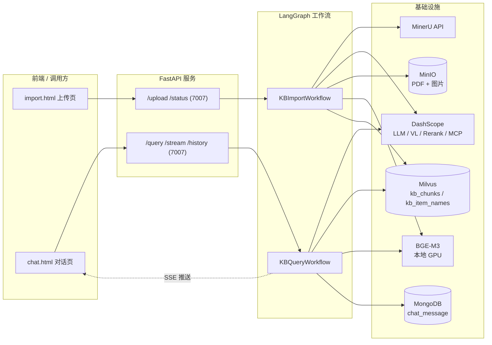
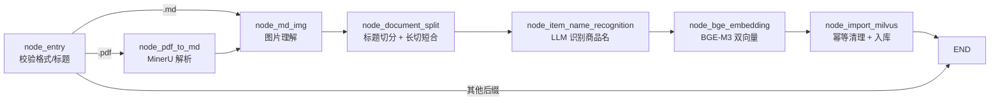
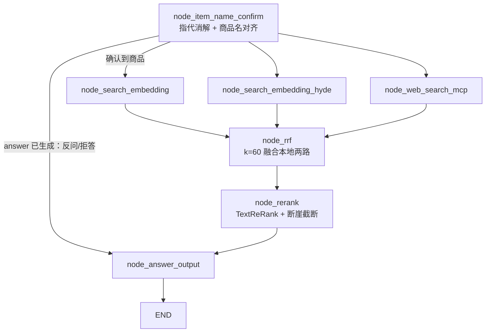

# 掌柜智库 · shopkeeper-wisdom

面向商家 / 设备手册场景的**知识库 RAG 系统**。基于 **LangGraph** 编排两条工作流（离线导入 + 在线查询），用 **FastAPI** 暴露上传、问答、流式输出与会话历史接口，并自带两个可直接访问的网页（导入页、对话页）。

核心思路：先把设备手册（PDF / Markdown）解析成结构化文本和带图片说明的切片，用 BGE-M3 生成**稠密 + 稀疏双向量**存入 Milvus；查询时先确认用户问的是**哪个商品型号**，再做**向量检索 / HyDE / 联网搜索**三路召回，RRF 融合 + Rerank 精排后由大模型生成带配图的答案。

---

## 1. 功能特性

**导入侧（离线建库）**

- 支持 `.pdf` / `.md` 两种入口格式，PDF 走 MinerU（`vlm` 模型）解析，自动轮询、下载 ZIP、解压并重命名 `full.md`
- Markdown 图片多模态理解：调用 VL 模型（默认 `qwen3-vl-flash`）为每张图生成中文摘要，图片上传 MinIO 并把 `` 替换为 `(MinIO URL)`
- 标题感知切片：按 Markdown 1–6 级标题粗切（跳过代码块内的 `#`），超长章节用 LangChain 递归分割器二次切分，过短章节同父标题合并
- 商品主体识别：LLM 读前 3 个切片（≤2500 字）识别「品牌 + 型号 + 品名」，回填到每个切片
- 双向量入库：BGE-M3 生成 dense(1024 维) + sparse 向量，按 `file_title` 做幂等清理后批量写入 Milvus，并按 UTF-8 字节数截断 VARCHAR 字段
- 节点级进度：每个节点在内存中登记运行/完成状态，前端可轮询实时看到「PDF转Markdown → 图片处理 → 文档切分 → …」

**查询侧（在线问答）**

- 主体确认：LLM 结合历史做指代消解、提取商品名并改写问题；用混合向量在 `kb_item_names` 中比对分数
  - 唯一高分（≥0.8）→ 直接确认
  - 多个高分 → 优先取与提取名完全一致的，否则取最高分
  - 无高分但有 ≥0.6 候选 → 反问用户「您是想问以下哪个产品：…」
  - 全部低于 0.6 → 拒绝：「抱歉，未找到相关产品…」，不再进入检索
- 三路召回（并行）：普通向量检索、HyDE（先让 LLM 生成假设答案再检索）、阿里百炼 MCP 联网搜索
- RRF（k=60）融合本地两路结果 → DashScope `TextReRank` 精排（本地切片 + 网页结果统一打分）→ **断崖截断**（TopK 3~10，相邻分差 ≥0.5 或相对差 ≥25% 即截断）
- 答案生成：拼装「参考内容 + 历史对话 + 关联商品 + 用户问题」（上下文预算 12000 字），支持流式 / 非流式；从切片中正则提取 Markdown 图片 URL，随答案推给前端渲染
- 会话记忆：MongoDB `chat_message` 存 user/assistant 消息、改写后问题、关联商品、图片 URL；支持查询与清空
- SSE 推送：`ready / progress / delta / final / error` 五种事件，前端可实时看到节点进度和逐字输出

---

## 2. 技术栈

| 层次 | 选型 |
| --- | --- |
| 语言 / 依赖管理 | Python ≥ 3.11，[uv](https://docs.astral.sh/uv/)（`pyproject.toml` + `uv.lock`，清华源 + pytorch cu128 源） |
| 工作流编排 | LangGraph（`StateGraph`，TypedDict 状态）、LangChain、langchain-text-splitters |
| Web 服务 | FastAPI + Uvicorn，`StreamingResponse` 实现 SSE，`BackgroundTasks` 跑长任务 |
| 大模型 | 阿里云 DashScope（OpenAI 兼容模式）：`qwen-flash` 作默认 LLM，`qwen3-vl-flash` 作视觉理解 |
| 向量模型 | BGE-M3（`pymilvus.model.hybrid.BGEM3EmbeddingFunction`，本地权重 + GPU/FP16） |
| 重排模型 | DashScope `TextReRank`（非本地 bge-reranker，配置项 `TEXT_RERANK_MODEL`） |
| 向量库 | Milvus（hybrid search + WeightedRanker，2.4+） |
| 文档解析 | MinerU 云端 API（`https://mineru.net/api/v4`，也可本地部署，见 `mineru本地部署.md`） |
| 对象存储 | MinIO（桶策略设为 Public Read，图片可直接 URL 访问） |
| 会话存储 | MongoDB（PyMongo 原生驱动） |
| 联网搜索 | MCP over streamable HTTP（百炼 `WebSearch`，工具名 `bailian_web_search`） |

---

## 3. 系统架构



---

## 4. 目录结构

```text
shopkeeper-wisdom/
├── config/                      # 各类配置单例（dataclass + .env）
│   ├── lm_config.py             # LLM / VL 模型、温度、max_tokens
│   ├── embedding_config.py      # BGE-M3 路径、设备、FP16
│   ├── milvus_config.py         # Milvus 地址与两个集合名
│   ├── mineru_config.py         # MinerU base_url / token
│   ├── minio_config.py          # MinIO 端点、密钥、桶、图片目录
│   ├── reranker_config.py       # DashScope 重排模型与 instruct
│   └── bailian_mcp_config.py    # MCP WebSearch 地址
├── processor/
│   ├── import_processor/        # 导入工作流
│   │   ├── main_graph.py        # 图结构、条件路由、执行入口
│   │   ├── state.py             # ImportGraphState + 默认状态
│   │   ├── config.py            # 切片/识别/限流等业务参数
│   │   ├── base.py              # BaseNode（日志、异常包装）
│   │   ├── exceptions.py        # 分层异常：File/Pdf/Embedding/Milvus…
│   │   └── nodes/               # a_node_entry … g_node_import_milvus
│   └── query_processor/         # 查询工作流
│       ├── main_graph.py        # 图结构、三路并发、条件路由
│       ├── state.py             # QueryGraphState
│       ├── base.py              # NodeBase
│       ├── nodes/               # confirm / 3 路召回 / rrf / rerank / answer
│       └── prompt/              # 4 个提示词模板（抽离，不硬编码）
├── fastapi/
│   ├── api/import_service.py    # 上传 + 状态查询 + 后台跑图
│   ├── api/query_service.py     # 查询 + SSE + 历史
│   └── page/import.html         # 上传页
│   └── page/chat.html           # 对话页（marked + DOMPurify 渲染）
├── utils/                       # 跨流程复用工具
│   ├── embedding_utils.py       # BGE-M3 单例 + 批量双向量
│   ├── milvus_utils.py          # 客户端单例、混合检索请求、转义
│   ├── mongo_history_utils.py   # 会话历史读写 + 索引
│   ├── sse_utils.py             # SSE 队列与生成器
│   ├── task_utils.py            # 内存态任务进度 + 节点中文名映射
│   ├── reranker_http_utils.py   # DashScope TextReRank 封装
│   ├── minio_utils.py           # MinIO 客户端 + Public Read 策略
│   └── llm_utils.py             # ChatOpenAI 工厂（JSON 模式、关思考）
├── tool/                        # logger（colorlog）与模型下载脚本
├── test/                        # 手工联调脚本（GPU / LLM / MinerU / Mongo / MCP / Web）
├── upload/                      # 上传原件，按 YYYYMMDD/{task_id}/ 分层
├── output/                      # MinerU 解压结果与生成的 Markdown
├── json/                        # 切片结果备份 {file_title}_chunks.json
├── pyproject.toml / uv.lock
├── .env.example                 # 配置模板（.env 已被 git 忽略）
└── mineru本地部署.md             # MinerU 本地化安装步骤
```

---

## 5. 两条 LangGraph 流水线

### 5.1 导入流水线（`KBImportWorkflow`）



| 节点 | 关键行为 | 状态变更 |
| --- | --- | --- |
| `node_entry` | 校验路径存在、后缀白名单；`file_dir` 指向项目 `output/` | `is_pdf/md_read_enabled`、`pdf_path`/`md_path`、`file_title`、`file_dir` |
| `node_pdf_to_md` | 申请 MinerU 上传链接 → PUT 上传 → 每 3s 轮询 batch 结果（上限 600s）→ 下载 ZIP → 解压 → `full.md` 改名 → 读全文 | `md_path`、`md_content` |
| `node_md_img` | 扫描 `images/`，只处理 MD 实际引用且格式支持的图片；VL 生成摘要（限 60s 10 次）；清空 MinIO 旧目录后上传；替换 MD 图片语法；另存 `_new.md` | `md_content`、`md_path` |
| `node_document_split` | 代码块内标题不计数；无标题则整篇一章；超 2000 字递归切分（分隔符：空行→换行→中英文标点）；不足 500 字且同父标题则合并；结果备份到 `json/` | `chunks`（title/content/parent_title/part/file_title） |
| `node_item_name_recognition` | 取前 3 片 / 2500 字上下文调 LLM；失败回退 `file_title`；商品名向量写 `kb_item_names`（按 item_name 删旧插新） | `item_name`、`chunks[].item_name` |
| `node_bge_embedding` | 每批 5 条，文本为 `item_name\ncontent`，生成 dense/sparse | `chunks[].dense_vector`、`chunks[].sparse_vector` |
| `node_import_milvus` | 校验向量字段、自动建集合（AUTOINDEX/COSINE + SPARSE_INVERTED_INDEX/IP）、按 `file_title` 删旧、批量插入并回填 `chunk_id` | `chunks[].chunk_id` |

### 5.2 查询流水线（`KBQueryWorkflow`）



| 节点 | 关键行为 | 状态产出 |
| --- | --- | --- |
| `node_item_name_confirm` | 读最近 10 条历史；LLM 输出 JSON（`item_names` + `rewritten_query`）；混合检索对齐打分；写回 MongoDB | `history`、`rewritten_query`、`item_names`、`answer` |
| `node_search_embedding` | 改写问题向量化，`item_name in [...]` 过滤，稠/稀权重 0.8/0.2，召回 10 条 | `embedding_chunks` |
| `node_search_embedding_hyde` | LLM 先写 300 字以内的「假设答案」，与问题拼接后检索 | `hyde_embedding_chunks`、`hyde_doc` |
| `node_web_search_mcp` | MCP 调 `bailian_web_search(count=3)`，解析 `pages[].snippet/url/title`；失败降级为空 | `web_search_docs` |
| `node_rrf` | 按 `chunk_id` 累加 `1/(60+rank)`，取 Top5 | `rrf_chunks` |
| `node_rerank` | 本地切片 + 网页结果统一格式后打分排序；断崖检测动态截断 | `reranked_docs`（含 `source` / `score`） |
| `node_answer_output` | 已有 answer 直接推；否则组装 Prompt 调 LLM（流式/阻塞）；提取图片；写历史；推 `final` 事件 | `prompt`、`answer` |

### 5.3 数据模型

**Milvus `kb_chunks`**（切片主集合）

| 字段 | 类型 | 说明 |
| --- | --- | --- |
| `chunk_id` | INT64 主键 auto | Milvus 自增 |
| `content` | VARCHAR(65535) | 切片正文（含标题前缀） |
| `title` / `parent_title` / `file_title` / `item_name` | VARCHAR(100) | 标题、父标题、源文件、商品名（按字节截断） |
| `part` | INT8 | 子切片序号 |
| `dense_vector` | FLOAT_VECTOR(1024) | AUTOINDEX / COSINE |
| `sparse_vector` | SPARSE_FLOAT_VECTOR | SPARSE_INVERTED_INDEX / IP（DAAT_MAXSCORE、L2 归一化） |

**Milvus `kb_item_names`**（商品名主集合）：`pk`、`file_title`、`item_name`、`dense_vector`(IVF_FLAT/COSINE)、`sparse_vector`。

**MongoDB `chat_message`**：`session_id`、`role`、`text`、`rewritten_query`、`item_names`、`image_urls`、`ts`；复合索引 `(session_id asc, ts desc)`。

---

## 6. 快速开始

### 6.1 安装依赖

```powershell
uv sync           # 按 pyproject.toml / uv.lock 建环境
uv tree           # 查看依赖树
```

首次使用 BGE-M3 时，若本地无权重会自动下载；也可用 `tool/download_bgem3.py` 预先拉取（默认落盘 `D:\ai_models\...`，按需修改）。

### 6.2 配置环境变量

```powershell
Copy-Item .env.example .env
```

`.env.example` 未覆盖但代码实际会读取的键，需要自行补上：

```dotenv
MINIO_IMG_DIR=upload-images        # MinIO 内图片目录前缀
LLM_MAX_TOKENS=2048                # llm_utils 会传给 ChatOpenAI
TEXT_RERANK_MODEL=gte-rerank-v2    # DashScope TextReRank 模型名
TEXT_RERANK_INSTRUCT=              # 可选重排指令
```

### 6.3 准备依赖服务

| 服务 | 默认地址 | 用途 |
| --- | --- | --- |
| Milvus | `http://localhost:19530` | 向量检索；集合不存在会自动创建 |
| MongoDB | `mongodb://localhost:27017` | 会话历史（库名默认 `kb001`） |
| MinIO | `localhost:9000` | PDF 原件与图片；首次连接自动建桶并设 Public Read |
| MinerU | `https://mineru.net/api/v4` | PDF 解析，需要 token；本地部署见 `mineru本地部署.md` |

### 6.4 启动服务

```powershell
# 导入服务：http://127.0.0.1:7007/import.html
uv run python fastapi/api/import_service.py

# 查询服务：http://127.0.0.1:7007/chat.html
uv run python fastapi/api/query_service.py
```

> ⚠️ 两个入口脚本的 `uvicorn.run` 都写死 `127.0.0.1:7007`，同时启动会端口冲突。请把其中一个改端口（例如查询服务改成 7008），或改为 `uvicorn fastapi.api.query_service:app --port 7008`。

Swagger 文档：服务启动后访问 `http://127.0.0.1:<port>/docs`。

---

## 7. API 一览

### 导入服务（`import_service.py`）

| 方法 | 路径 | 说明 |
| --- | --- | --- |
| GET | `/import.html` | 上传页面 |
| POST | `/upload` | `multipart/form-data`，字段 `files`（可多选）。落盘到 `upload/YYYYMMDD/{task_id}/`，同步传 MinIO `pdf_files/YYYYMMDD/`，随后为每个文件起一个后台 LangGraph 任务 |
| GET | `/status/{task_id}` | 返回 `status`（pending/processing/completed/failed）、`done_list`、`running_list`（中文节点名） |

上传响应：

```json
{ "code": 200, "message": " 文件上传成功, total: 2", "task_ids": ["uuid-1", "uuid-2"] }
```

### 查询服务（`query_service.py`）

| 方法 | 路径 | 说明 |
| --- | --- | --- |
| GET | `/chat.html` | 对话页面 |
| POST | `/query` | 请求体 `{query, session_id?, is_stream?}`。流式时立即返回 `session_id` 并由后台跑图；非流式同步返回 `answer` |
| GET | `/stream/{session_id}` | SSE（`text/event-stream`），事件：`ready`、`progress`、`delta`、`final`、`error` |
| GET | `/history/{session_id}?limit=50` | 会话历史（`_id`/`role`/`text`/`rewritten_query`/`item_names`/`ts`） |
| DELETE | `/history/{session_id}` | 清空会话，返回 `deleted_count` |
| GET | `/health` | 健康检查 |

流式调用推荐顺序：先 `POST /query {is_stream:true}` 拿到 `session_id`，再 `GET /stream/{session_id}` 收增量与最终答案（`final` 事件里带 `image_urls` 和节点进度清单）。

---

## 8. 可调参数速查

| 位置 | 参数 | 默认值 | 说明 |
| --- | --- | --- | --- |
| `import_processor/config.py` | `max_content_length` | 2000 | 切片最大字符数 |
| 同上 | `min_content_length` | 500 | 低于此值尝试与同父标题合并 |
| 同上 | `item_name_chunk_k` | 3 | 商品识别使用的切片数 |
| 同上 | `item_name_chunk_size` | 2500 | 商品识别上下文上限 |
| `f_node_bge_embedding.py` | `batch_size` | 5 | 每批向量化条数，按显存调整 |
| `b_node_pdf_to_md.py` | `timeout_seconds` / `poll_interval` | 600 / 3 | MinerU 轮询策略 |
| `c_node_md_img.py` | `max_requests` / `window_seconds` | 10 / 60 | VL 摘要滑动窗口限流 |
| `node_item_name_confirm.py` | 确认阈值 | 0.8 / 0.6 | 高置信直接确认 / 中置信反问 |
| `node_rrf.py` | `k` / `max_results` | 60 / 5 | RRF 常数与融合后条数 |
| `node_rerank.py` | `RERANK_MIN/MAX_TOPK`、`GAP_ABS`、`GAP_RATIO` | 3/10、0.5、0.25 | 断崖截断策略 |
| `node_answer_output.py` | `MAX_CONTEXT_CHARS` | 12000 | Prompt 上下文总预算 |

---

## 9. 已知问题与改进建议

以下是读代码时确认存在的点，按影响排序：

1. **端口冲突**：两个 FastAPI 入口都监听 `7007`，需手动改其中一个。
2. **硬编码绝对路径**：`d_node_document_split.py` 的备份目录、`e_node_item_name_recognition.py` 的 chunks 兜底读取路径、`main_graph.py` 的 `__main__` 示例，都写死了本机绝对路径（形如 `C:\Users\<用户名>\Desktop\project\shopkeeper-wisdom\...`）。换机器即失效，建议改为「项目根 / json」动态拼接。
3. **运行中状态不会自动清除**：节点里只调 `add_running_task`，从不调 `add_done_task`；导入侧靠 `import_service.run_graph_task` 的 stream 循环补记完成，查询侧只有 `node_answer_output` 补记。结果是中间节点会长期留在 `running_list`，前端进度显示不准。
4. **`node_web_search_mcp` 在同步节点里 `asyncio.run`**：若未来把图放进已有事件循环的异步上下文，会抛 `RuntimeError: event loop is already running`；建议改为异步节点或独立线程池执行。
5. **Milvus 过滤表达式直接拼 Python list**：`f'item_name in {item_names}'` 得到的是单引号列表字面量，依赖 Milvus 解析且未转义；商品名含引号时会破坏表达式。建议用 `escape_milvus_string` 后显式拼 `["a","b"]`。
6. **无商品名时全库检索**：`item_names` 为空会退化为跨产品检索，容易召回串型号内容，可考虑加相似度下限或直接拒答。
7. **阈值文档与实现不一致**：`_step_6_align_item_names` 文档写「>0.85」，代码用 `>=0.8`，需统一口径。
8. **`.env.example` 不全**：缺 `MINIO_IMG_DIR`、`LLM_MAX_TOKENS`、`TEXT_RERANK_MODEL`、`TEXT_RERANK_INSTRUCT`，照模板配置会缺键。
9. **依赖声明偏宽**：`openai-agents`、`peft`、`datasets`、`sync`、`tree`、`path`、`httpx2` 在源码中基本未直接使用（`httpx2` 仅 MCP 节点用到），可清理以缩短安装时间。
10. **调试脚本与业务代码混放**：根目录 `test/` 混有临时打印、模型下载等脚本；`__main__` 里也留着大量本地路径示例，建议迁到 `scripts/` 并改用 pytest。
11. **任务进度与结果只存在内存**：单进程重启即丢，且无法多 worker；生产需换 Redis 等外部存储。
12. **图片 URL 依赖 MinIO 公网策略**：`minio_utils` 把桶设为 Public Read，内网可用，但对公网暴露需另加访问控制。

---

## 10. 相关文档

- `mineru本地部署.md`：MinerU 本地安装、模型下载源与 CUDA 版 torch 安装步骤
- 各节点文件末尾的 `output_state` / `__main__` 示例：可直接当作单节点调试的输入样例
- `test/`：`gpu_test.py`、`llm_test.py`、`mineru-test.py`、`mongodb_test.py`、`test_mcp.py` 用于逐项验证外部依赖是否连通
